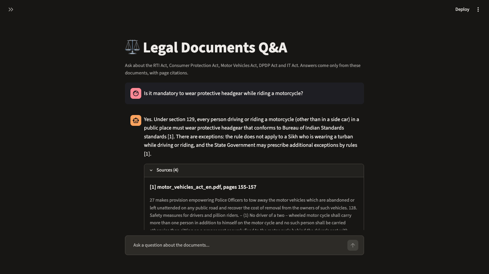
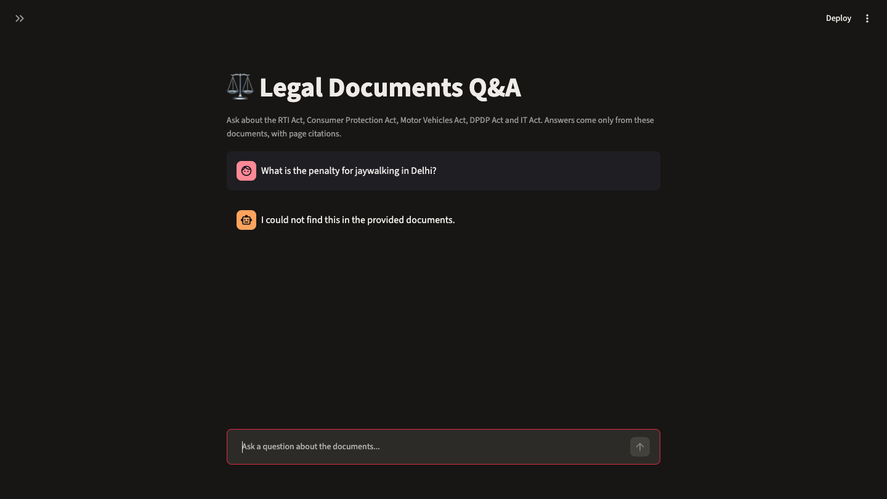

# Indian Legal Documents RAG

Ask questions about five Indian laws and get answers with page-level citations. The app refuses questions the documents don't cover.

**Documents:** RTI Act 2005, Consumer Protection Act 2019, Motor Vehicles Act 1988, Digital Personal Data Protection Act 2023, IT Act 2000.




## How it works

```
PDFs -> clean + chunk (page-aware) -> embeddings (bge-small) -> ChromaDB
Question -> dense search + BM25 keyword search -> rank fusion -> cross-encoder reranker
         -> top passages (+ following chunks) -> LLM via OpenRouter or Groq -> answer + citations
```

- **Backend:** FastAPI (`/ask`, `/health`)
- **Frontend:** Streamlit chat with a sources panel and a model switcher (any model id of the configured provider)
- **Everything runs on free tools:** local embeddings and reranker, free-tier OpenRouter or Groq models

## Results

I wrote my own test questions with the correct page and answer for each, in two sets. The first set (11 questions) was used while tuning. The second set (13 questions) was written afterwards and not used for tuning.

**Retrieval: is the right page in the top 5?**

| Method | Set 1 (11 q) | Set 2 (13 q, original labels) | Set 2 (after label review) |
|---|---|---|---|
| Dense (embeddings only) | 7/11 | 7/13 | 11/13 |
| Hybrid (dense + BM25) | 8/11 | 7/13 | 11/13 |
| Hybrid + reranker | **10/11** | **9/13** | **13/13** |

On review, 4 of my own page labels in set 2 were one page too high (the section started on the previous page). I corrected them only where the PDF text showed the answer on that page.

**Answer quality** (24 answerable questions, an LLM judge compares each answer with my reference answer):

| Version | Correct | Partial | Wrong |
|---|---|---|---|
| Before adding following-chunks context and retrieval tuning | 19/24 | 3/24 | 2/24 |
| Current | **22/24** | 2/24 | 0/24 |

**Refusals:** 3/3 out-of-scope questions were correctly refused (e.g. jaywalking fines, a state minimum wage).

**Answer-model comparison** (13 held-out questions, one run each, judged by `qwen/qwen3.8-27b`):

| Answer model | Correct | Partial | Wrong |
|---|---|---|---|
| openai/gpt-oss-120b (Groq) | 12/13 | 1/13 | 0/13 |
| openai/gpt-oss-20b (Groq) | 12/13 | 1/13 | 0/13 |

Both models missed the same detail on one question (an "as soon as practicable" qualifier on the RTI transfer rule). With 13 questions and one run each, the two are effectively tied. Refusal check on 3 out-of-scope questions: 3/3.

Caveats: single runs; an LLM judge can be lenient or strict; the questions were also used to tune retrieval, so scores are optimistic. An earlier run with a same-family judge scored 13/13 for the 120b model, which shows how much the judge choice matters.

### Limitations
- Small test sets (24 questions). The numbers show the approach works, not that it is 100% reliable.
- The final configuration was tuned on questions I had already seen, so treat the scores as optimistic.
- The judge is itself a free LLM, and free models vary from run to run and have daily rate limits.
- English only for now. Hindi/Hinglish and voice input are planned.
- The RTI PDF is a scan, so its text has small OCR errors.
- Not legal advice.

## Choose an LLM provider

The answer model is called through an OpenAI-compatible API. Set these in `.env`:

```
OPENROUTER_API_KEY=your_key_here
GROQ_API_KEY=your_key_here
LLM_PROVIDER=groq
LLM_MODEL=openai/gpt-oss-120b
```

Use `LLM_PROVIDER=openrouter` with an OpenRouter model id to switch. Free tiers have rate limits, and model ids change over time.

## Run it yourself

1. Clone and install (Python 3.11):
   ```
   git clone https://github.com/anasilahi10/indian-legal-rag.git
   cd indian-legal-rag
   uv sync
   ```
   Or with pip: `python3.11 -m venv .venv && source .venv/bin/activate && pip install -r requirements.txt`
2. Create `.env` from `.env.example` and add your OpenRouter API key.
3. Download the PDFs into `data/raw/` using these names:

   | File name | Source |
   |---|---|
   | `rti_act_en.pdf` | https://cic.gov.in/sites/default/files/RTI-Act_English.pdf |
   | `consumer_protection_act_en.pdf` | https://consumeraffairs.gov.in/public/upload/files/CP%20Act%202019_1732700731.pdf |
   | `motor_vehicles_act_en.pdf` | https://chdtransport.gov.in/sites/default/files/documents/MVA1988.pdf |
   | `dpdp_act_en.pdf` | https://www.indiacode.nic.in/bitstream/123456789/22037/2/a2023-22.pdf |
   | `it_act_en.pdf` | https://www.cca.gov.in/sites/files/pdf/ACT/ACT2000.pdf |

4. Build the index:
   ```
   uv run python -m backend.ingest
   uv run python -m backend.index
   ```
5. Start the backend and the chat screen in two terminals:
   ```
   uv run uvicorn backend.main:app --port 8000
   uv run streamlit run frontend/app.py
   ```

## Evaluate

```
uv run python -m scripts.evaluate_retrieval                               # set 1
uv run python -m scripts.evaluate_retrieval data/eval/questions_holdout.csv   # set 2
uv run python -m scripts.evaluate_answers                                 # answer quality
uv run python -m scripts.evaluate_refusals                                # out-of-scope questions
```

## Project structure

```
backend/    ingest, index, retriever, rag (LLM call), FastAPI app
frontend/   Streamlit chat screen
scripts/    evaluation scripts
data/eval/  test questions with expected pages and answers
```

## Roadmap
- Hindi / Hinglish questions with a multilingual embedding model
- Voice input (Whisper)
- Section-aware chunking, and OCR cleanup for scanned PDFs
- Docker image and a hosted demo